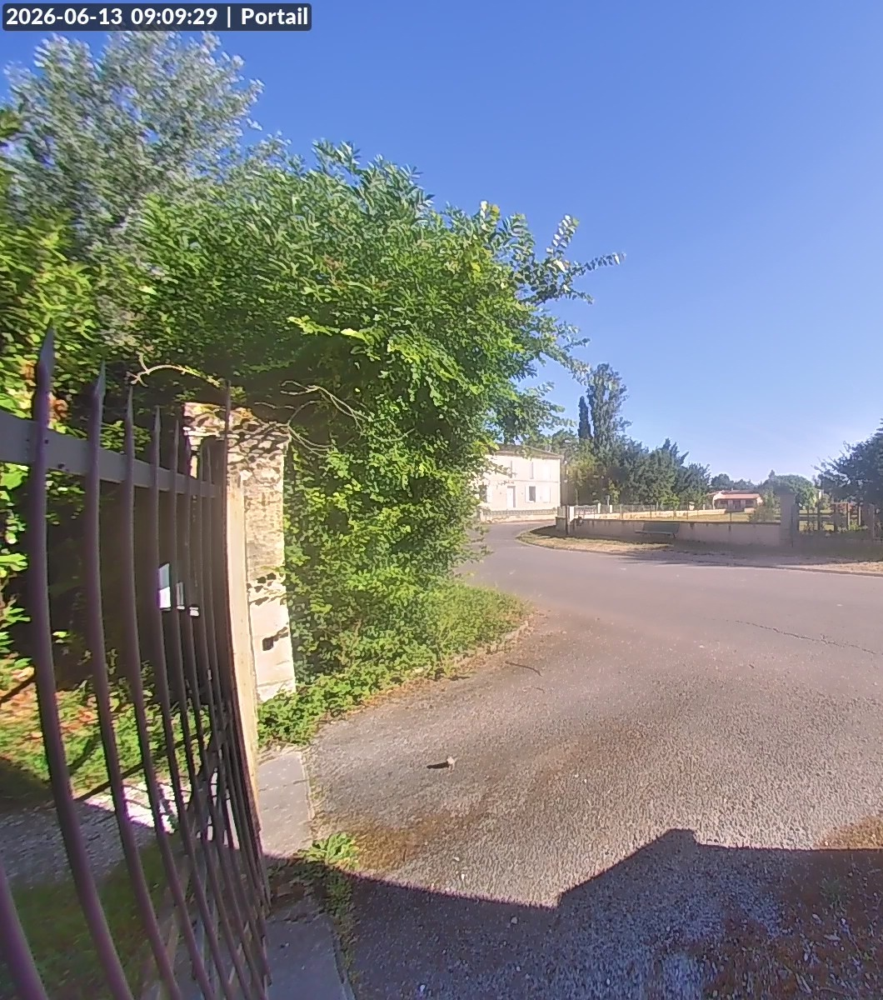
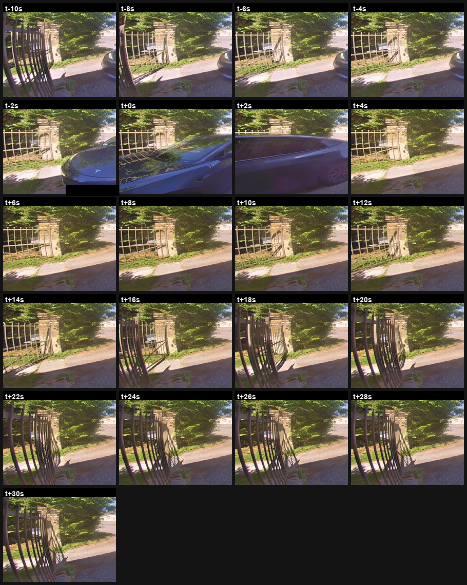
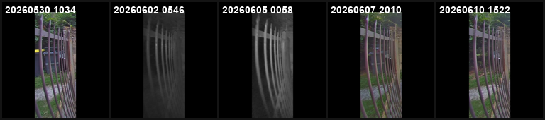
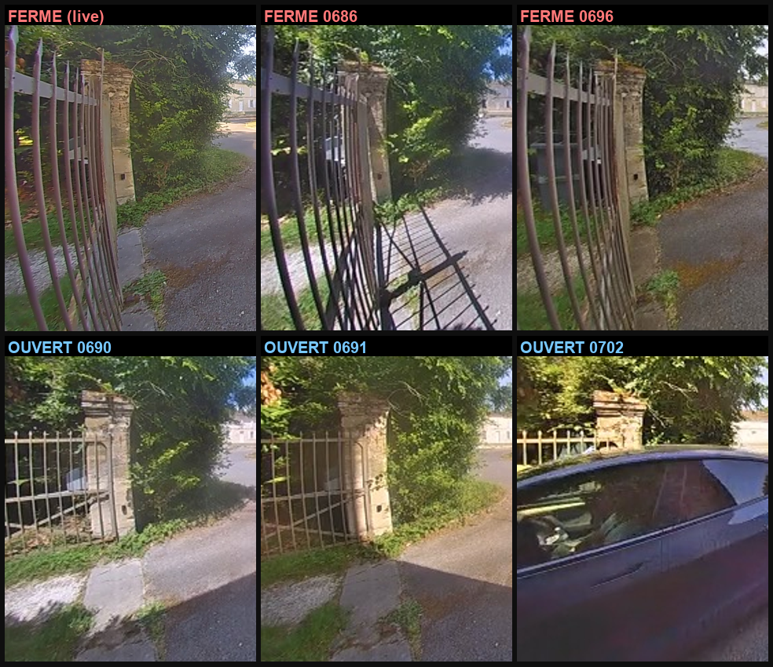
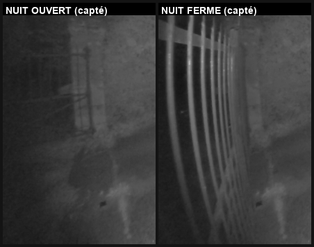
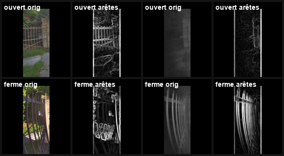
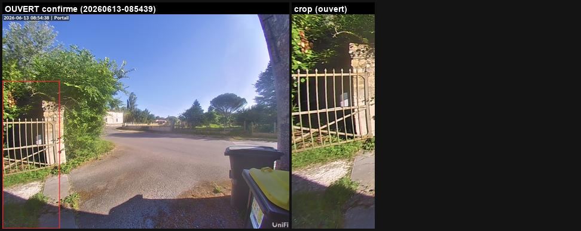

> First published in French on the [Home Assistant French community forum](https://forum.hacf.fr/t/mon-portail-est-il-reste-ouvert-je-lai-demande-a-une-camera-et-a-un-peu-de-machine-learning/80989). Translated, trimmed, and followed by what happened next.

It started with a simple question: when I leave in the morning, did I close the gate? My doorbell camera sees it from the side. So rather than fitting a magnetic contact and running a cable, I wondered whether the camera could tell me itself.

It can. It runs on a small machine at home and shows up in Home Assistant as a `binary_sensor`. But the result is not the interesting part. The interesting part is that the thing that cost me the most time had nothing to do with the model.

## Classify, don't detect

When people hear "camera and AI", they reach for object detection. Useless here: I don't need to *locate* the gate, only to know whether it is **open** or **closed**. That's binary image classification, the most basic case in computer vision, and a small model of that kind runs comfortably anywhere.

The project split into two parts: a **factory** that produces the model (collect images, label them, train) and a **runtime** that runs it and exposes the result to Home Assistant.

## Step 1: collect images

Whatever your camera, you need two things: a way to **extract images**, and **examples of every situation**: open and closed, day and night, sun and rain. Mine is UniFi Protect, but the method transfers to any RTSP camera. What follows is mostly about the traps of building the dataset, and those are universal.

**Find the rare state.** The gate only changes when something goes through. So I targeted the moments when something moves: the camera already timestamps its detections, and I extract a few full frames around each one. (Not the detection thumbnails: they're cropped on the car, which hides the gate.) Nearly 1,900 images over five weeks.

**Use a signal that guarantees the state.** A detection "in the zone" also fires for a car driving past on the road, gate closed. Noisy. A **line-crossing** trigger, a virtual tripwire across the entrance, is different: a crossing *guarantees* the gate is open. The principle transfers to any setup: any signal that guarantees the state (a tripwire, another sensor, a time window) harvests reliable examples without blind labelling. It took my clean "open" class from a few dozen to several hundred images.

**Beware of how you sample.** My dataset ended up overwhelmingly *open*, while in real life the gate is closed 99 % of the time. Of course: I was capturing events, events are people going through, and people go through open gates. A closed gate at rest triggers nothing. The fix was a plain **timelapse** of the continuous recording, one frame every 50 minutes for two weeks: hundreds of *closed* frames in every light, including infrared at night.

**Or make the state yourself.** My gate is driven by a Home Assistant script that sends a pulse. Starting from a known state and counting pulses, I know the state *without guessing it from the image*: closed, pulse, open, capture, pulse, closed, capture. Perfect for the conditions I was missing, with labels guaranteed right.

## Step 2: keep what's representative

Event clips produce bursts of nearly identical frames, and the timelapse adds hundreds of similar *closed* ones. So I deduplicated: a tiny 32×32 grayscale fingerprint per image, a pixel distance, and an image is kept only if it differs enough from every image kept so far. That distance keeps the variety of light (day and night stay far apart) while collapsing the bursts of a single passage. The volume dropped three- to fourfold, without losing a single real situation.

## Step 3: labelling is the real work

If you keep one thing from this post, keep this: **success is decided here, far more than in the choice of model.**

The signal is subtler than it looks. The fixed fence is always in frame, with its vertical bars, whether the gate is open or not, so "bars" doesn't mean "closed", and any naive automatic labelling breaks on it. The real tell, once you know it: closed, the leaf crosses the opening with its **curved, oblique bars**; open, only the **straight verticals** remain and the driveway is clear. At night the infrared makes the metal glow, which is even easier to read than daylight.

That tell is purely geometric, which suggests a trick. Turn the image into an **edge map** and the bars stand out while day and night start to look alike: the light changes, the geometry doesn't. In the end I didn't need it, clean labels were enough, but it's a good card to keep up your sleeve if lighting ever becomes the problem.

Labelling hundreds of images one by one isn't sustainable, so I did it in two passes. First, **cluster** similar images automatically on the gate area, which gives a pre-classification that's roughly right. Then **confirm by hand, fast**, in a tiny local web page: a grid of pre-sorted thumbnails, one click to flip a label, two more buttons for "in transition" and "exclude" (a car hiding everything). It's a lot of annotation, in as many situations as possible: day, night, rain, cars on the road, people walking by, even a few frames with a stroller.

The difference was stark. With sloppy labels I plateaued at **75 %** validation accuracy. After that careful manual pass (525 open, 218 closed), it jumped to **99 %**. The model wasn't the problem; the noise in the labels was. On a subtle signal, clean labels are worth ten rounds of model tuning.

## Step 4: crop, then train

The model doesn't get the whole image, only the region that changes: a vertical strip on the left, defined in fractions of the frame rather than pixels, so it works at any resolution. Since the strip is tall and narrow, I don't squash it into a square (that would distort the bars); I pad it onto a black square before resizing. And the same preprocessing code runs for training and inference, otherwise what the model learns and what it sees drift apart.

Nothing exotic for training, and that's good: transfer learning on **MobileNetV3-Small**, class weights for the imbalance, augmentation on brightness, contrast and zoom, but **never a horizontal flip**: the left-right geometry of the gate *is* the signal. Exported to TFLite, the model weighs under 2 MB. In real tests, driving the gate open and closed: 6 out of 6, with huge margins.

One more lesson, because it got me: **a good validation score can lie.** An early version looked fine on paper and failed miserably on "gate open, no car, at dusk", a case the data barely covered. Only a real-world test revealed it.

## Step 5: plug it into Home Assistant

Rather than a throwaway "gate" script, I wrote a **generic add-on**: you give it a list of detectors (camera, model, region, labels), and each one becomes a sensor. A new `.tflite` file and one line of config make a new sensor, nothing to rebuild. The add-on fetches frames from Home Assistant itself, so no camera credentials are stored anywhere, and exposes a small `/state` endpoint that a REST `binary_sensor` reads. On top, a `cover` entity of type gate: its state comes from the sensor, its buttons trigger the pulse script.

## What happened next

**The sensor died the very next day.** It stayed stuck on *closed*, with no error anywhere. The camera had rebooted in the middle of the night and its encoder froze on a frame from that moment, for about thirteen hours, while both Home Assistant and the NVR still reported it as connected. The model was right about a picture that was no longer the present. A vision sensor needs to check that its input is alive (that the image actually changes) before trusting what it says about it. 

**The recipe was reused within days.** The same factory and the same add-on now tell me whether someone is in the pool: one more model, one more line of config. The tripwire trick didn't transfer (nobody "crosses" into a pool), so positives came from swims organised for the purpose.

**Readers asked good questions.** The post got a few replies on the forum, and my answers belong here.

*Why not Frigate?* A reader pointed out that Frigate has offered state classification since version 0.17, and uses it to double-check what their gate motor reports (a motor that says "closed" when it actually stopped on an obstacle). I had three reasons not to go that way: my cameras already live in UniFi Protect and I didn't want a second NVR for one classifier, that Frigate feature was brand new, and I wanted to learn by building it. If I were starting from scratch with Frigate already running, it's the first thing I would try. The lessons about the dataset apply either way.

*Why not close the gate automatically?* Physical safety is already handled upstream: the motor's photocells stop the gate if a car or a person is in the way. The real risk is elsewhere. My only command is a toggle pulse, with no reliable state feedback from the hardware. If the model gets it wrong and sees a closed gate as open, an automation meant to close it would open it, in the middle of the night. I'll automate the day I have a second, independent source of state to cross-check.

*What about the misses?* My model doesn't learn continuously either, but the pipeline makes retraining cheap: every misclassified image goes back into the review tool, I fix its label in one click and retrain. That's how I handled my own hard cases, at night and against the light.

## What I keep from it

- **Labels first.** The biggest gain didn't come from the model but from a one-click manual review.
- **Understand your signal.** The right tell (curved bars versus verticals) came from looking at the scene, not from the algorithm, and an edge map makes it visible.
- **Watch how you sample.** Capturing only events drowned me in *open*; a timelapse of the quiet hours fixed it.
- **Test for real, and keep testing.** Offline validation isn't enough, and a frozen camera will fool a perfect model.
- **Don't let a single classifier act alone.** Reading the state is one thing; acting on it needs a second, independent source.
- **Separate the factory from the runtime.** A generic add-on turned a hack into a small platform.

A small camera, a 2 MB model, and one less question every morning.
